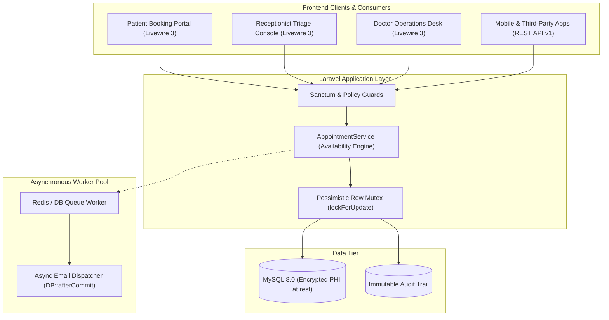
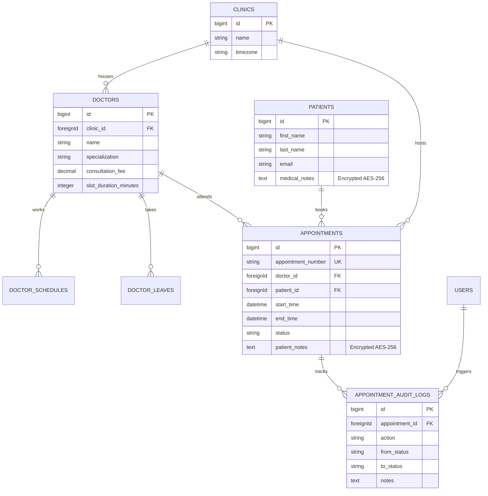

# 🏥 CuraPoint — Clinic Scheduling & Patient Workflow Platform

[](https://github.com/your-username/clinic-scheduling/actions)


> An enterprise-grade clinical scheduling and operations engine. Built to demonstrate **concurrency-safe transactional booking**, **dynamic availability algorithms**, **HIPAA-aligned encrypted sensitive data (PHI)**, and **asynchronous queued notifications**.

---

## 🏛️ System Architecture



---

## 📊 Entity Relationship Diagram (ERD)



---

## 🔑 Key Engineering Signals

### 1. Concurrency-Safe Booking (Pessimistic Row-Locking)
When two users attempt to book the identical 30-minute interval simultaneously, a race condition occurs. CuraPoint guards this operation inside an atomic transaction:
```php
DB::transaction(function () use ($doctor, $patient, $startTime, $endTime) {
    Doctor::where('id', $doctor->id)->lockForUpdate()->first();

    $overlap = Appointment::active()
        ->where('doctor_id', $doctor->id)
        ->where('start_time', '<', $endTime)
        ->where('end_time', '>', $startTime)
        ->exists();

    if ($overlap) {
        throw new AppointmentConflictException("Slot no longer available.");
    }

    // Insert Appointment & Audit Log atomically
});
```

### 2. Encryption at Rest for Sensitive Health Information (PHI)
Patient medical notes are cast with Laravel's native `'encrypted'` cast:
```php
protected $casts = [
    'medical_notes' => 'encrypted', // Automatically encrypted with AES-256-CBC
];
```

### 3. Asynchronous Queues via `DB::afterCommit()`
Email confirmations are dispatched to a background queue only after database transactions commit cleanly:
```php
DB::afterCommit(function () use ($appointment, $patient) {
    $patient->notify(new AppointmentBookedNotification($appointment));
});
```

---

## 🧪 Automated Test Suite

Includes automated unit, feature, and concurrency collision tests:
```bash
php artisan test
```

Test breakdown:
- `AppointmentAvailabilityTest`: Validates schedule boundaries, lunch intervals, holiday leaves, and past slot filtering.
- `AppointmentConcurrencyTest`: Simulates simultaneous requests against the same slot and verifies `AppointmentConflictException` is thrown.

---

## 👥 Demo Credentials for Evaluators

| Role | Email | Password | Access Level |
| :--- | :--- | :--- | :--- |
| **Attending Doctor** | `sarah@metrohealth.example.com` | `password` | Clinical Console, status completions, medical notes |
| **Receptionist** | `reception@metrohealth.example.com` | `password` | Front-desk triage, waiting room check-in queue |
| **Administrator** | `admin@metrohealth.example.com` | `password` | Full clinic & provider configuration |

---

## 🛠️ Local Setup

```bash
# 1. Clone & Install
git clone https://github.com/your-username/clinic-scheduling.git
cd clinic-scheduling
composer install
npm install

# 2. Setup Environment
cp .env.example .env
php artisan key:generate

# 3. Migrate & Seed Realistic Clinical Data
php artisan migrate:fresh --seed

# 4. Start Services
npm run dev
php artisan serve
```
